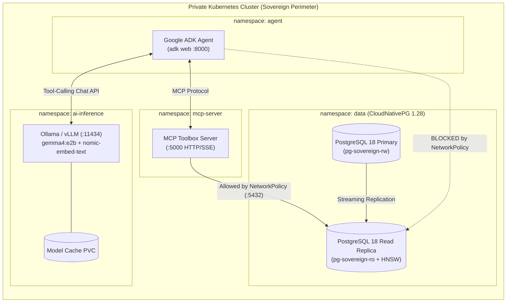

# GenAI in a Box: Building a Sovereign AI Platform on Kubernetes

[](https://kubernetes.io/)
[](https://github.com/pgvector/pgvector)
[](https://cloudnative-pg.io/)
[-4285F4)](https://ai.google.dev/gemma)
[](https://github.com/googleapis/genai-toolbox)

> **Open-Source Reference Architecture & Blueprint:** *Deploy a self-service, Zero-Trust GenAI platform on Kubernetes—from a local laptop (`Kind`) to air-gapped Bare Metal or Private Cloud.*

## Overview

The rise of autonomous AI agents has created a dilemma for Infrastructure, SRE, and Platform Engineering teams: developers want to ship agentic workflows fast, but sending sensitive records to public SaaS LLM APIs breaks **data sovereignty policies** and introduces **unpredictable per-token FinOps bills**.

**The solution: Bring the AI to your data.**

This repository provides a **100% open-source, sovereign "GenAI in a Box" reference platform on Kubernetes** combining:
1. **Stateless Open-Weights Inference & Local Embeddings (`namespace: ai-inference`):** **Gemma 4** (`gemma4:e2b`) + **`nomic-embed-text`** (for 100% in-cluster 768-dim semantic vector generation via `/api/embed`) served via **Ollama** (for CPU/sandbox clusters) or **vLLM + KEDA** (for high-concurrency GPU production), backed by persistent model weight caching (`PVC`).
2. **Zero-Trust Integration Gateway (`namespace: mcp-server`):** **MCP Toolbox for Databases** exposing strictly scoped, parameterized SQL + vector tools over the **Model Context Protocol (MCP)**.
3. **Stateful Relational + Vector Engine (`namespace: data`):** **PostgreSQL 18 + `pgvector`** managed declaratively by **CloudNativePG (CNPG 1.28)** with PG18 Asynchronous I/O (`io_method: worker`), Primary/Read-Replica isolation, `Guaranteed` QoS memory protection, separate WAL storage, and `HNSW` vector indexing.
4. **Agent Orchestration (`namespace: agent`):** **Google ADK (Agent Development Kit)** running a **Healthcare Clinical Trial Matcher** over synthetic Patient Health Information (PHI) with **zero bytes of external internet egress**.

---

## Architecture



### Key SRE & Database Engineering Patterns Included

- **100% Sovereign In-Cluster Embedding Generation ([`k8s/03-data-hydration-job.yaml`](k8s/03-data-hydration-job.yaml)):**
  - Avoids the classic "embedding leak" trap (where teams self-host the LLM and `pgvector`, but accidentally call an external API to compute vectors).
  - During hydration, the `data-loader` Job calls the in-cluster Ollama `/api/embed` endpoint (`nomic-embed-text`) to compute **real 768-dimensional semantic embeddings (`vector(768)`)** from each patient's clinical record and each clinical trial's eligibility criteria before building the `HNSW` index.
- **PostgreSQL 18 + `pgvector` Day-2 Operations ([`k8s/02-postgres-cnpg-cluster.yaml`](k8s/02-postgres-cnpg-cluster.yaml)):**
  - **PostgreSQL 18 Standard Image (`ghcr.io/cloudnative-pg/postgresql:18-standard-trixie`):** Includes `pgvector` pre-installed and enables PG18's new **Asynchronous I/O (`io_method: worker`)**.
  - **HNSW Memory Cliff Protection:** Configures `Guaranteed` QoS (`requests == limits`) alongside tuned `shared_buffers` and `maintenance_work_mem` so HNSW graph traversal never triggers unexpected Linux OOMKills.
  - **Read-Replica Vector Offloading:** `mcp-toolbox` connects exclusively to the CloudNativePG Read-Only service (`pg-sovereign-ro.data.svc.cluster.local`), isolating SIMD-heavy cosine distance (`<=>`) calculations from primary OLTP writes.
  - **Dedicated WAL vs. Data Storage:** Separates `storage` (data + HNSW indexes) from `walStorage` on persistent volumes.
- **Zero-Trust Database Perimeter ([`k8s/01-network-policies.yaml`](k8s/01-network-policies.yaml)):** Neither the ADK Agent nor the LLM pod holds database credentials or network routes to `namespace: data`. Only `mcp-toolbox` is permitted by `NetworkPolicy` to reach port `5432`.
- **Day-1 CPU (`Ollama`) to Day-2 GPU (`vLLM` + `KEDA`) Portability:**
  - Deploy [`k8s/04-ollama-inference.yaml`](k8s/04-ollama-inference.yaml) on standard CPU nodes (`e2-standard-4`) with zero GPU quota.
  - Swap in [`k8s/04-vllm-gpu-inference.yaml`](k8s/04-vllm-gpu-inference.yaml) when scaling to GPU node pools with **KEDA** queue-depth autoscaling (`vllm:num_requests_waiting`)—without changing a single line of Agent or MCP code.

---

## Repository Structure

```text
genai-in-a-box-k8s/
├── Makefile                                  # End-to-end local, cloud & live demo automation
├── .github/workflows/genai-box-cicd.yaml     # CI/CD Policy-as-Code Gate & ArgoCD GitOps workflow
├── catalog/                                  # Corporate Self-Service Catalog & Guardrail Linter
│   ├── backstage-template.yaml               # Backstage IDP Software Template definition
│   ├── policy_gate.py                        # CI Policy-as-Code Linter (FinOps, Security & DB SRE)
│   └── requests/clinical-research-claim.yaml # Example self-service claim from a Business Unit
├── terraform/                                # GCP VPC, Cloud NAT, Artifact Registry & Private GKE
├── k8s/                                      # Declarative Kubernetes manifests (Kustomize)
│   ├── 00-namespaces.yaml                    # Isolated namespaces: data, ai-inference, mcp-server, agent
│   ├── 01-network-policies.yaml              # Zero-trust NetworkPolicy for PostgreSQL 18
│   ├── 01-resource-quotas.yaml               # FinOps ResourceQuotas (T-Shirt sizing: €0.00/token)
│   ├── 02-postgres-cnpg-cluster.yaml         # CloudNativePG Cluster (PG18 + pgvector, Primary + Replica)
│   ├── 03-data-hydration-job.yaml            # Loads CSVs, computes 768-dim embeddings via Ollama, builds HNSW
│   ├── 04-ollama-inference.yaml              # Default CPU inference & embeddings (Ollama + gemma4:e2b + nomic)
│   ├── 04-vllm-gpu-inference.yaml            # Production GPU inference alternative (vLLM + KEDA)
│   ├── 05-mcp-toolbox.yaml                   # MCP Toolbox for Databases (relational + pgvector tools)
│   └── 06-adk-agent.yaml                     # Google ADK Web UI deployment
├── gitops/                                   # Self-service ArgoCD Application manifest
└── src/
    ├── catalog_portal.py                     # Corporate AI Service Catalog & CI/CD Portal (:8080)
    ├── generate_data.py                      # Synthetic PHI CSV generator
    └── clinical_trial_matcher/               # Google ADK Sovereign Agent (:8000)
```

---

## Quickstart Guide

You can deploy this entire 4-namespace Sovereign GenAI stack **locally on your laptop** (using Podman, Docker, Minikube, Colima, or Rancher Desktop) or on a **private cloud Kubernetes cluster** (GKE via Terraform).

### Option A: Quickstart with Docker + Kind (macOS or Linux)

Make sure Docker (or OrbStack / Colima / Rancher Desktop) has at least **6 CPUs and 12 GB RAM** allocated, and `kind` + `kubectl` are installed:

```bash
make local-all
```
*(The `Makefile` automatically detects `docker` if installed, or falls back to `podman`.)*

---

### Option B: Local Deployment with Podman + Kind (No Docker Desktop Required)

Ideal for environments (`macOS Apple Silicon` or `Linux`) using **Podman**:

#### 1. Prerequisites
```bash
brew install podman vfkit kind kubernetes-cli
```

#### 2. Initialize the Rootful Podman Machine (`6 CPUs`, `12 GB RAM`, Apple Hypervisor)
On macOS Apple Silicon, configuring `provider = "applehv"` in `~/.config/containers/containers.conf` ensures both the Podman CLI and **Podman Desktop** use Apple's native Virtualization framework (`vfkit`) instead of `krunkit`:

```bash
make local-podman-init
```
*(If you already have an older Podman machine created with `krunkit` or fewer resources, run `podman machine stop && podman machine rm -f` before `make local-podman-init`.)*

#### 3. Create the Cluster, Build the Agent, and Deploy All 4 Namespaces
```bash
make local-all CONTAINER_ENGINE=podman
```
Under the hood, `make local-all`:
1. Creates a local `kind` cluster (`genai-box`) and installs **CloudNativePG 1.28.0**.
2. Builds the **Google ADK** container and loads the archive into Kind.
3. Deploys all 4 namespaces (`data`, `ai-inference`, `mcp-server`, `agent`), waits for the **PostgreSQL 18** primary + read-replica cluster to become `Ready`, and runs the in-cluster `nomic-embed-text` (`vector(768)`) hydration job.

- **Using Minikube (with Docker or Podman driver):**
  ```bash
  minikube start --cpus=6 --memory=12288
  make install-cnpg
  docker build -f src/Dockerfile.agent -t localhost/genai-box/agent:latest .
  minikube image load localhost/genai-box/agent:latest
  make local-deploy-box
  ```

---

### Option C: Cloud Deployment on Private GKE Cluster with Terraform

#### 1. Provision the Private GKE Cluster (`e2-standard-4` CPU Nodes, Zero GPUs Required)

```bash
export PROJECT_ID=your-gcp-project-id
export REGION=us-central1

make tf-init
make tf-apply PROJECT_ID=$PROJECT_ID REGION=$REGION
make get-credentials PROJECT_ID=$PROJECT_ID REGION=$REGION
```

#### 2. Install the CloudNativePG 1.28 Operator (Supports PostgreSQL 18)

```bash
make install-cnpg
```

#### 3. Build the ADK Agent Image & Deploy the "GenAI Box"

```bash
make build-agent PROJECT_ID=$PROJECT_ID REGION=$REGION
make deploy-box PROJECT_ID=$PROJECT_ID
```

---

## Live Demo Experience: Internal AI Service Catalog (:8080) + Agent Studio (:8000)

Once the cluster is running, launch the complete **Platform Engineering + Agent Demo** with a single command:

```bash
make demo
```

This opens two local web interfaces (plus an interactive SRE CLI walkthrough):
1. **`http://localhost:8080` — Healthcare Tu Salud Internal AI Service Catalog & Platform Control Plane:**
   - **Landing Page & Stages 1–2 (Consumer / Department View):** Business units describe their goal in plain English (e.g., Clinical Research matching confidential patient records to trials) and select a predictable **FinOps T-Shirt Size (`Small CPU: €140/mo` vs `Large GPU: €650/mo`, both at `€0.00/token`)**.
   - **Stage 3 (Platform Engineer Perspective — CI/CD & GitOps):** Inspect the auto-generated 12-line `GenAIBoxClaim`, GitHub Actions Policy-as-Code Gate (`catalog/policy_gate.py`), `ResourceQuota`, `NetworkPolicy`, and `CloudNativePG` manifests reconciled via ArgoCD.
   - **Stage 4 & Live Terminal X-Ray (`make demo-sre`):** Run `make demo-sre` in a second terminal tab to step through live Kubernetes & PostgreSQL 18 SRE checks (`ResourceQuota`, `NetworkPolicy`, Read-Replica `DROP TABLE` rejection, and `< 1 ms` HNSW `EXPLAIN ANALYZE`).
2. **`http://localhost:8000` — Provisioned Google ADK Agent Studio:**
   - Select `clinical_trial_matcher` in the top-left dropdown and try an autonomous multi-step prompt:
   > *"Find our patients diagnosed with Melanoma. For the youngest patient, check their current medications, match them to the top eligible clinical trials with similarity scores, and give a brief summary."*
   - Or test Type 2 Diabetes matching:
   > *"Find our patients diagnosed with Type 2 Diabetes. Pick the youngest female patient, check her current medications, and match her to the top eligible clinical trials with similarity scores."*

---

## Verifying PostgreSQL 18 + `pgvector` HNSW Index Execution

```bash
kubectl exec -it pg-sovereign-2 -n data -c postgres -- psql -U postgres -d healthcaredb -c "
SELECT version(), pg_is_in_recovery() AS is_read_replica, current_setting('io_method') AS aio_method;
SET enable_seqscan = off;
EXPLAIN ANALYZE
SELECT t.trial_id, t.title, ROUND((1 - (t.trial_embedding <=> p.profile_embedding))::numeric, 4) AS score
FROM clinical_trials t
JOIN patients p ON p.patient_id = 'P0033'
WHERE p.age <= t.max_age
ORDER BY t.trial_embedding <=> p.profile_embedding
LIMIT 3;
"
```

---

## License & Disclaimer

Licensed under the [Apache License, Version 2.0](LICENSE).

*Disclaimer: This is an open-source community reference architecture and educational blueprint, not an officially supported Google product.*
